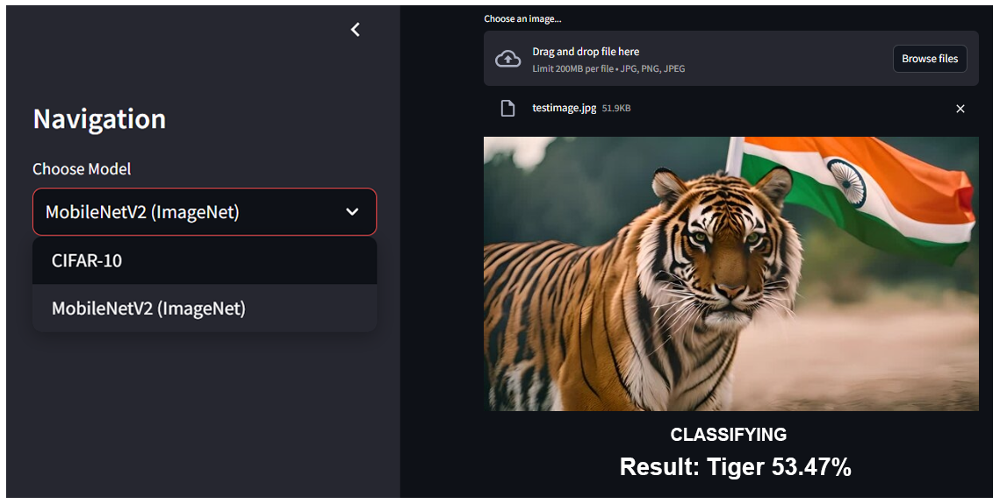

# Image Classification by Machine Learning Using Python
---


This project is a **Streamlit application** designed to perform image classification using two powerful machine learning models: **MobileNetV2** and a custom **CIFAR-10 model**. The application allows users to upload images and receive predictions along with confidence scores. It features a user-friendly navigation bar for seamless switching between models and delivers real-time results. This app is ideal for educational purposes, showcasing the performance of state-of-the-art models, and practical use in various image classification scenarios.

---

## **✨ Key Features**

### 1. **Dual Model Support**

- **📱 MobileNetV2 (ImageNet)**:
  - Recognizes 1,000 different classes from the ImageNet dataset.
  - Includes everyday objects, animals, vehicles, and more.
  - Lightweight and optimized for mobile and web applications.

- **🖼️ Custom CIFAR-10 Model**:
  - Specializes in classifying images into ten categories: 
    - ✈️ Airplane, 🚗 automobile, 🐦 bird, 🐱 cat, 🦌 deer, 🐶 dog, 🐸 frog, 🐴 horse, 🚢 ship, and 🚚 truck.
  - Designed for smaller-scale image classification tasks.

### 2. **Intuitive Interface**

- **🔀 Sleek Navigation Bar**:
  - Effortlessly switch between MobileNetV2 and CIFAR-10 models using a sidebar menu.

- **⏱️ Real-Time Predictions**:
  - Upload images in JPG or PNG format and receive instant classification results.
  - Displays predictions along with confidence scores for better understanding.

### 3. **Educational and Practical Benefits**

- **📘 Educational Value**:
  - Learn about deep learning models, their architecture, and real-world performance.
  - Experiment with two different model types for comparative analysis.

- **💡 Practical Applications**:
  - Use the app for tasks requiring quick and accurate image classification.

---

## **🚀 Getting Started**

### **🛠️ Prerequisites**
- Python 3.7 or later.
- A modern web browser to access the application.

### **⚙️ Installation**

Follow the steps below to set up and run the application locally:

1. **📥 Clone the Repository**:
   ```bash
   git clone https://github.com/tbhvishal/Image-Classification-By-Machine-Learning-Using-Python-AICTE-Internship-Project.git
   cd Image-Classification-By-Machine-Learning-Using-Python-AICTE-Internship-Project
   ```

2. **🔧 Create and Activate a Virtual Environment**:
   ```bash
   python -m venv venv
   source venv/bin/activate   # On Windows use `venv\Scripts\activate`
   ```

3. **📦 Install Dependencies**:
   ```bash
   pip install -r requirements.txt
   ```

4. **▶️ Run the Application**:
   ```bash
   streamlit run app.py
   ```

5. **🌐 Open the App**:
   - The app will automatically open in your default web browser.
   - If it doesn’t, navigate to [http://localhost:8501](http://localhost:8501).

---

## **📖 Usage Instructions**

1. **🔘 Select the Model**:
   - Use the navigation bar to choose either the MobileNetV2 or CIFAR-10 model.

2. **📤 Upload an Image**:
   - Click on the upload button to select a JPG or PNG image file.

3. **📊 View Results**:
   - Observe the classification results and confidence scores displayed on the screen.

4. **🔄 Switch Models**:
   - Easily switch between models to compare their performance on the same image.

---

## **📂 File Structure**

```
Image-Classification-By-Machine-Learning-Using-Python-AICTE-Internship-Project/
├── app.py               # Main Streamlit application file.
├── models/              # Directory containing model files and utilities.
├── requirements.txt     # Python dependencies.
├── README.md            # Project documentation.
└── assets/              # Additional resources (images, icons, etc.).
```

---

## **🔧 Technologies Used**

- **Streamlit**: For creating an interactive and user-friendly web application.
- **TensorFlow/Keras**: For implementing and loading deep learning models.
- **Python**: The core programming language used for development.

---

## **🤝 Support This Project**

- ⭐ **Star the Repository**: If you find this project helpful, please consider starring the repository on GitHub.
- 🔗 **Share the Repository**: Share it with others who might find it useful, especially students working on their internship projects or learning image classification.
- 👨‍💻 **Follow Me on GitHub**: Stay updated with my latest projects by following my GitHub profile: [tbhvishal](https://github.com/tbhvishal).

---

## **🌟 Contributing**

We welcome contributions to improve this project! Follow these steps to get involved:

1. Fork the repository.
2. Create a new branch for your feature or bug fix:
   ```bash
   git checkout -b feature-name
   ```
3. Commit your changes:
   ```bash
   git commit -m "Add feature-name"
   ```
4. Push your branch:
   ```bash
   git push origin feature-name
   ```
5. Open a pull request on GitHub.

---

## **🙏 Acknowledgements**

- **Streamlit**: For providing an amazing framework for building interactive applications.
- **TensorFlow**: For enabling efficient implementation of deep learning models.
- **AICTE Internship**: For inspiring this project.

---

## **📜 License**

This project is licensed under the [MIT License](LICENSE).

---

## **📧 Contact**

For any queries or suggestions, feel free to reach out:
- GitHub: [tbhvishal](https://github.com/tbhvishal)
- Email: [soon](soon)
